<picture>
  <source media="(prefers-color-scheme: dark)" srcset="./sketch-dark.svg">
  
</picture>

Hi, I'm Marnix. I study IT in Amsterdam.

Most of what I do on here is fixing bugs in AI agent tools, mainly [Hermes Agent](https://github.com/NousResearch/hermes-agent). I also built a model router for it. Before that I spent five months testing Google's Gemini, mostly trying to get it to say things it shouldn't.

In summer I help run a small campsite in Noord-Holland, which explains the tent. The paper plane is left over from studying aviation engineering.

Mostly Python and TypeScript, a bit of Rust. Easiest way to reach me is [LinkedIn](https://www.linkedin.com/in/marnix-dejong-205291240).
